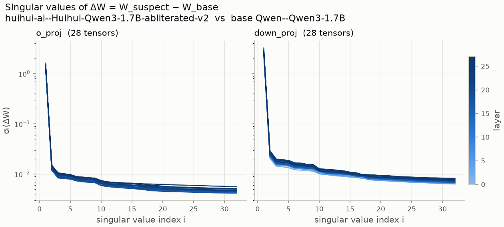

# llmscan

[](https://github.com/anon5376/llmscan/actions/workflows/ci.yml)

Check whether the abliterated or uncensored model you downloaded is only what it claims to be.
llmscan diffs the suspect's weights against the base model it says it came from, one tensor at a
time, and reports where and how they differ.

> **Status: early.** The full pipeline works: loader, tensor inventory, ΔW spectra, suspicion ranking
> and plots. On six real abliterated models, both halves of the hypothesis hold (below). llmscan
> ranks suspicion; it never certifies a model clean.

## Hypothesis

Honest abliteration ([Arditi et al., 2024](https://arxiv.org/abs/2406.11717)) finds one refusal
direction $\hat r$ in the residual stream and projects it out of the matrices that write to it:

$$W' = W - \hat r \hat r^{\top} W$$

So for an honest abliteration, $\Delta W = W_{\text{suspect}} - W_{\text{base}}$ should be:

- close to rank 1 in every modified matrix;
- confined to matrices that write to the residual stream (`o_proj`, `down_proj`, and in some
  implementations the token embedding);
- zero everywhere else: norms, `lm_head`, `q/k/v_proj` and `gate/up_proj` stay bit-identical to base.

A backdoor fine-tune (LoRA or full) should leave a more diffuse, higher-rank delta, often in places
abliteration never touches. Anything outside the abliteration signature is a finding. Some uploads
add a "healing" fine-tune after the projection, which legitimately raises the rank, so the
comparison is against a distribution of honest abliterations, not a single threshold.

## First result: where six public abliterations changed the weights

Base models `Qwen/Qwen3-1.7B` and `Qwen/Qwen3-0.6B` (28 layers each), each compared with three
popular abliterated derivatives from four different toolchains. Each cell counts how many of the
28 per-layer matrices of that type differ from base. Every other tensor is identical to base in all
six models, including the embeddings, all norms, `q/k/v_proj` and `gate/up_proj`.

| Suspect | `o_proj` changed | `down_proj` changed |
|---|---|---|
| `huihui-ai/Huihui-Qwen3-1.7B-abliterated-v2` | 28 / 28 | 28 / 28 |
| `mlabonne/Qwen3-1.7B-abliterated` | 28 / 28 | 28 / 28 |
| `Goekdeniz-Guelmez/Josiefied-Qwen3-1.7B-abliterated-v1` | 27 / 28 (layer 0 untouched) | 27 / 28 (layer 0 untouched) |
| `DavidAU/Qwen3-0.6B-heretic-abliterated-uncensored` ([Heretic](https://github.com/p-e-w/heretic)) | 26 / 28 (layers 2–27) | 9 / 28 (layers 19–27) |
| `huihui-ai/Huihui-Qwen3-0.6B-abliterated-v2` | 28 / 28 | 28 / 28 |
| `mlabonne/Qwen3-0.6B-abliterated` (re-saved as fp32; compared by value) | 28 / 28 | 28 / 28 |

The "confined to residual-writing matrices" part holds for all six, and none of these toolchains
touches the embedding. Josiefied's model card describes a fine-tune, yet only `o_proj` and
`down_proj` changed.

## Second result: every honest ΔW is rank 1

For every changed matrix, llmscan computes the singular values of ΔW and its effective rank, the
participation ratio $(\sum_i \sigma_i^2)^2 / \sum_i \sigma_i^4$. A rank-1 edit scores 1, and
$r$ equal directions score $r$.

| Suspect | effective rank, median (max) | $\sigma_1/\sigma_2$, median |
|---|---|---|
| `huihui-ai/Huihui-Qwen3-1.7B-abliterated-v2` | 1.010 (1.011) | 111 |
| `mlabonne/Qwen3-1.7B-abliterated` | 1.007 (1.008) | 142 |
| `Goekdeniz-Guelmez/Josiefied-Qwen3-1.7B-abliterated-v1` | 1.010 (1.011) | 117 |
| `DavidAU/Qwen3-0.6B-heretic-abliterated-uncensored` | 1.006 (1.036) | 143 |
| `huihui-ai/Huihui-Qwen3-0.6B-abliterated-v2` | 1.005 (1.007) | 167 |
| `mlabonne/Qwen3-0.6B-abliterated` | 1.021 (1.483, layer 0) | 63 |

Medians and maxima pool the `o_proj` and `down_proj` deltas of each model. In five of the six, every
ΔW is one spike followed by a noise floor roughly 100× lower. `mlabonne/Qwen3-0.6B-abliterated`
carries a weaker second direction in its first and last layers (layer 0: $\sigma_1/\sigma_2 \approx 9$).



With these stats, llmscan's ranking puts every changed tensor of all six models in T4, "consistent
with abliteration": no false positives. Next: a modified model whose changes llmscan has to find
blind.

## Use

From a clone of this repo:

```sh
pipx install .            # or: uv tool install .
llmscan --base path/to/Qwen3-1.7B --suspect path/to/Qwen3-1.7B-abliterated
```

Output goes to `out/<suspect>-vs-<base>/`:

- `pair.txt`: the two models this directory belongs to; a different pair with the same default
  directory name is refused, pass `--out`. llmscan also refuses any non-empty directory without a
  `pair.txt` (for example a model directory) and never deletes a file. This holds for `--out` too:
  a directory marked for another pair is refused, and so is a `pair.txt` with other hard links.
  A directory carrying this pair's `pair.txt` is llmscan's output directory, and files in it with
  llmscan's output names (below) are replaced on a rerun, even ones you added later. Every output
  is written to a temporary file in a private `.llmscan-*` directory (mode 0700 on POSIX) inside
  `--out`, then renamed onto its name, so a symlink or hard link already on that name is replaced,
  never written through, and other users cannot redirect a write even in a shared directory such as
  `/tmp`. On POSIX llmscan refuses, before creating anything, an `--out` that group or others can
  write to without the sticky bit (or with it, if another ordinary user owns it), and the same
  for any existing ancestor directory: such a directory can be renamed by another user, who could
  then plant a symlink where llmscan writes (`/tmp`, which has the sticky bit and is owned by
  root, and a normal home directory pass). It checks the fully resolved path and writes only
  through it, and creates missing directories mode 0700. The check reads mode bits only; it does
  not evaluate ACLs, so an ACL that grants other users write access to a directory is not
  detected. On Windows, use an output directory that other users cannot write to. llmscan
  protects your files against mistakes and pre-existing filesystem state (a wrong `--out`, stale
  outputs, links already in the output directory). Other processes running as you can already
  change your files directly, so racing them is out of scope;
- `inventory.csv`, `inventory.txt`: every tensor in either model, marked identical, changed,
  dtype/shape mismatch, or missing from one side;
- `delta.csv`: for each 2-D tensor, the top-k singular values of ΔW and its effective rank;
- `spectra.png`, `effective_rank.png`.

Safetensors checkpoints (single file or sharded directory) are memory-mapped and read one tensor at
a time. The inventory compares tensors in chunks, so it needs a few megabytes of RAM
whatever the model size (4.2 MB of allocations measured on a pair of 160 MB tensors); the ΔW scan loads the two copies of one 2-D tensor at a time as float32, so
RAM must hold twice the float32 size of the largest 2-D tensor (4 bytes per element each). CPU only; the only
dependencies are numpy and matplotlib, no torch. GGUF support is next.

`scripts/fetch_hf.sh <org/name> <revision> <dir>` downloads a model's safetensors at a pinned revision.

## How suspects are ranked

`ranking.csv` orders every non-identical tensor, most suspicious first, with a plain-language
`reason` per row. A float re-save with identical values counts as identical and is not ranked.

1. **T1, structure:** present in only one model, shape mismatch, or a non-float dtype mismatch.
2. **T2, unexpected location:** changed, but not an `o_proj`, `down_proj` or `embed_tokens` (GGUF:
   `attn_output`, `ffn_down`, `token_embd`; MoE expert down projections count as `down_proj`). Change the
   set with `--expected-kinds`. The inventory also checks for a common BF16 working-precision
   re-save when non-projection locations change in at least two layers. Every F16/F32 value at
   those locations, including unchanged tensors, must exactly match rounding the base to BF16
   with ties to even. The inventory keeps the changed rows and records the verified re-save.
   Such rows at unexpected locations receive T4 with an explicit reason.
3. **T3, unusual change to an expected kind.** A full scan checks four properties.

   - **Spectral shape.** The original `--outlier-factor` rule compares effective rank to its kind's median
     (default 3×). A smaller increase can also qualify when it exceeds both 1% of the median and six
     MAD-based standard deviations, and the second mode contains at least a quarter of the non-leading energy.
     This distinguishes a second coherent mode from diffuse rounding noise.
     The full scan also measures the Frobenius distance to the best rank-one change using the entire
     spectrum, even with `-k 1` or tied singular values. It subtracts a conservative allowance for a
     floating-point re-save of a projected base matrix (one ULP at the coarser checkpoint precision,
     including subnormal spacing). The remaining distance divided by the change norm is
     `rank_one_excess`, a lower bound on the fraction of the change unexplained by a single removal
     and rounding. Above 5% it can flag a singleton. With eight or more measurements of the same kind
     and shape, it must also exceed their median by five percentage points and six MAD-based standard
     deviations. This allows for editing methods that consistently remove several directions.
   - **Projection fit and magnitude.** For a residual writer, projection gain is σ₁ divided by the norm of the base weights along
     the leading output direction. A full orthogonal projection along that direction gives gain one. A gain
     above `--outlier-factor` (with a minimum bound of one) is a finding even without peers. The adaptive
     check compares log magnitudes within the same kind and shape. Gain must exceed both 1.05 and 105% of
     its peer median. Raw Frobenius or spectral norms require a twofold increase. Both checks also require
     six MAD-based standard deviations. A full scan fits the signed leading change to a partial or full
     removal of the base projection. `projection_error` measures the unexplained fraction of the leading
     change in norm. The unexplained leading component has norm `a = σ₁ × projection_error`. All
     other modes together have norm `b`. With at least eight comparable measurements (same kind,
     shape and storage precisions), the scanner compares both fit error and leading share of the
     residual norm, `a / hypot(a, b)`. For small errors, the fit must exceed `max(1, --outlier-factor)`
     times the upper peer noise level. That level is the median plus six MAD-based standard deviations,
     with a minimum dispersion allowance of `sqrt(float64 epsilon)`. The leading share must also
     exceed its median by both five percentage points and six MAD-based standard deviations.
     Larger errors can qualify under the original rule. The error must exceed 5% and, with at least
     eight comparable fits, exceed its median by five percentage points and six MAD-based standard
     deviations. It must also have an unusually high leading share (as above) or satisfy
     `a > --outlier-factor × b`. The latter check also works on singletons.
     Current reports store `tail_norm_fraction` from the scaled spectrum so this comparison also works
     at subnormal F64 scales. Older reports estimate the tail from their recorded norms.

     A separate check uses the unexplained leading coefficients as a unit input vector `z`.
     If `Δ = −αuuᵀB` removes a unit direction from the base `B` with strength `0 ≤ α ≤ 1`,
     then `(B + 2Δ)z = (I − 2αuuᵀ)Bz` has norm at most `‖Bz‖`.
     The scanner measures half the growth in norm along this input, allows for entrywise
     rounding of both checkpoints and arithmetic error, and reports the positive remainder
     divided by `‖Δ‖F` as `contraction_excess`. This check is independent of the spectral
     tail and works on a single tensor. With eight or more comparable fits, the signed fit
     error must also exceed the peer median by six MAD-based standard deviations and the
     numerical floor above. This accommodates systematic departures from partial removal.
     A zero result means the chosen input yielded no evidence of excess growth.

     Partial removal also makes `BᵀS` symmetric for the edited matrix `S = (I − αuuᵀ)B`.
     Swapping two input probes must therefore preserve the cross response, `(Bx)ᵀ(Sy) = (By)ᵀ(Sx)`.
     The scanner probes the normalized base coefficients along the leading output direction and
     the orthogonal part of the unexplained coefficients. It bounds rounding of each response
     from both checkpoints, including subnormal and arithmetic error. `reciprocity_excess` reports
     the fraction of the observed discrepancy beyond that bound. The same peer fit-error check
     applies when a cohort is available.
     The symmetry identity also holds for removals along several axes. With no unique leading
     direction, the scanner uses a reproducible dense probe of `BᵀΔ − ΔᵀB` to select a pair
     of input coordinates. It checks their cross response against entrywise rounding bounds.
     With eight or more comparable multi-mode measurements, the excess must also exceed the
     peer median by six MAD-based standard deviations and the numerical floor.

     For a removal of any rank, write `S = (I − P)B` with `0 ≼ P ≼ I` and `Δ = S − B`.
     Every input then satisfies `(Sx)ᵀΔx = −(Bx)ᵀ(I − P)P(Bx) ≤ 0`. The scanner searches
     for a positive value using the largest eigenvalue of the symmetric form on a small
     input subspace. It uses the full input space up to dimension eight and a reproducible
     eight-vector range sketch for larger tensors. It checks the selected input against both
     checkpoints' entrywise rounding intervals and a float64 arithmetic allowance.
     If that input is inconclusive, the scanner refines the sketch and tests selected
     columns jointly. The exact matrix `SᵀΔ` is symmetric negative semidefinite,
     so its inner product with any matrix whose symmetric part is positive semidefinite
     is nonpositive. Each weight has one rounding error shared across the selected inputs.
     Combining their coefficients before applying the entrywise intervals can certify
     a violation that separate response bounds miss. On the selected columns (up to
     1,024 columns and 1,048,576 weights), the scanner also looks for a plane of
     coherent reciprocity error. It sketches the action of the skew form and checks
     the strongest plane it finds against both original storage intervals. This test
     applies even when every measured quadratic response is nonpositive.
     The next joint search uses at most 256 columns and runs when the initial gap
     exceeds the individual first-order allowances of both checkpoints.
     A positive quadratic response on these seed columns can also trigger a wider
     fit. The scanner compares it with the root mean square Frobenius scale of
     linearized, independent uniform storage errors. Seeds that exceed the measured
     Frobenius norm of the skew defect times the squared input norm also qualify.
     An inconclusive skew plane can independently trigger the same fit when
     neither checkpoint's rounding errors alone can account for its gap.
     Every finding must still survive the full entrywise intervals. The wider
     fit uses the midpoints to adjacent storage values as interval endpoints,
     with a float64 arithmetic allowance. This accounts for unequal spacings
     at powers of two and uniform spacing among subnormals.
     The scanner keeps the larger of the skew-plane
     margin and the margin from the joint interval search for peer comparison.
     It searches for a witness by moving the two matrices within their storage
     intervals to reduce the positive and skew parts of the linearized Gram form.
     For each candidate witness it bounds the **original quadratic** over every
     row's two intervals. A convex lower bound keeps the shared rounding errors
     in the linear and quadratic terms. A positive minimum of its tangent plane
     certifies a violation even with adversarially aligned rounding.
     This fallback can require up to 512 dense eigensolves for a candidate tensor.
     `removal_excess` is the fraction of the measured positive value beyond this budget.
     A zero means the search found no certificate. With eight or more comparable tensors,
     the excess must also exceed the cohort's upper outer fence (third quartile plus three
     interquartile ranges) by the numerical floor. This accounts for editing methods that
     systematically depart from the partial-removal model.
   - **Residual direction.** Each layer gets one vote in its stack and residual width. Writers within a
     voting layer must agree up to sign. When a strict majority agrees (absolute cosine ≥0.9), the scanner
     compares each writer and embedding to at least three *other* agreeing layers. For writers with eight
     other comparable layers (same stack, kind, shape and storage precision), the scanner converts the
     median absolute cosine to an orthogonal component, `sqrt(1 − cosine²)`. Each peer layer contributes
     one median component. A finding must exceed both `max(1, --outlier-factor)` times the peer median
     and the median plus six MAD-based standard deviations, with a floor for dot-product roundoff.
     Two nearby, mutually aligned same-kind axes can explain gradual drift. The scanner checks whether
     their angular trajectory predicts the held-out direction within the same tolerance, interpolating
     by layer index or extrapolating by at most one observed interval. For smaller cohorts and token
     matrices, the fallback flags a median absolute cosine below 0.5.
     An embedding or output head above the blocks can use a unique descendant
     stack of matching width. Output heads retain their location tier. The scanner uses a direction only
     when σ₁ > 2σ₂ or there is a single mode.
   - **Multi-direction edits.** A writer can have both a unique leading direction and several
     measurable secondary modes. Each retained singular value must exceed a storage
     rounding allowance and the numerical floor of the Gram matrix. For writer
     subspaces the scanner can tighten the whole-tensor allowance by summing the two
     checkpoints' entrywise rounding radii and taking their Frobenius norm. It retains
     the largest leading group resolved under either allowance, including when the
     tighter allowance falls inside a cluster of similar singular values.
     A twofold gap separates the selected modes from the remaining spectrum. A tall matrix
     can also have a measurable output space spanning all its input modes.
     The scanner compares resolved output spaces across layers of the same stack, writer kind,
     shape and storage precision, including a resolved line among higher-rank spaces.
     For ranks `p` and `q`, the overlap between orthonormal bases yields `min(p, q)` principal
     angles. The largest measures departure from containment and is invariant to basis rotation.
     If the smaller space lies inside the larger, all paired angles are zero.
     A higher-rank layer can introduce an extra direction outside a coherent majority
     space. For each candidate rank ceiling, the scanner tests whether the layers at
     or below it form a strict majority with at least eight measured writers.
     Fixed-plane anchors and moving forecasts require at least two layers
     resolving the full reference rank. Lower-rank layers
     contribute their own containment measurements and strength bounds, even when
     their resolved directions differ within the reference plane.
     The scanner compares the strength of each layer's unpaired modes with an
     upper bound on the majority edits in the entire orthogonal complement.
     For a fixed or forecast plane, it also bounds the strength that must remain
     outside any plane within the angular matching tolerance. This accounts for
     rotation of a strong mode when a weak mode becomes measurable. It tracks
     strength in that same complement across depth, so adjacent expansions can point
     in different directions. At least one layer in a run must clear every reference
     interval after both measurement allowances. A contiguous transition layer must
     independently clear the intervals of a strict majority of the whole cohort.
     Both outer boundaries must show a resolved jump relative to ordinary steps in
     the reference and within the run at the same confidence level. A terminal run
     with one boundary requires a continuous measured trajectory.
     If the majority space drifts with depth, the scanner also estimates a reference
     along the shortest Grassmann geodesic between flanking full-rank anchors.
     Each anchor is held out when measuring its prediction error and
     complement strength. At a majority endpoint, two remaining majority
     layers predict at most one anchor interval beyond their observations.
     The local reference must reduce the worst angular error
     relative to the best fixed representative by the outlier factor. Average
     drift across gaps must agree with rates measured over uninterrupted background
     intervals. Lower-rank observations in those intervals can reveal a turn
     between the full-plane measurements.
     Beyond either end of the majority, two majority layers predict the reference
     at the candidate depth. The scanner checks forecasts over the same anchor
     spacing, distance and direction against held-out majority layers. Their
     worst angular error widens the complement-strength intervals before the
     scanner tests for an abrupt expansion. A distance without a measured
     comparison supplies no forecast.
     The scanner also fits a principal ambient span to the majority observations,
     independently of their depth order or adjacent angular steps. Each writer is
     held out in turn and projected onto the span of the remaining writers.
     The scanner selects the smallest common number of principal axes that explains
     each such projection within the angular tolerance and contains the whole
     held-out writer within the coherence radius. At that dimension, every fit
     must agree with the full fit's orientation. A direction unique to one writer
     contributes its measured strength to the held-out bound.
     Additional modes must lie within the coherence radius of
     the orthogonal complement. Only their component outside the span counts
     toward expansion strength. The scanner can also track a majority plane
     from either side through consecutive measured spaces. This can resolve a
     boundary obscured by ordinary motion in the shared span. For a tracked run,
     each reference compares boundary jumps with steps measured in its own
     coordinates. Complement strength stays measurable as the tracked plane
     leaves the span, so those layers still calibrate ordinary motion. The
     ambient span tests a boundary when it matches both boundary layers.
     The scanner also checks both continuation bounds.
     Each step must retain the incoming plane within the ordinary
     angular step allowance. The incoming plane measures complement strength
     before its projection into the layer supplies the next reference. At a
     lower-rank layer, tracking updates the observed directions and carries the
     orthogonal part of the incoming plane forward.
     The ambient reference bounds strength outside any continuation within
     its angular matching tolerance. Tracking uses an independent majority
     observation to bound strength that could come from a hidden turn.
     Its allowance covers ordinary motion over that distance and the largest
     majority turn observed at the same distance.
     In a short segment a single resolved amplitude jump can separate two levels
     when every remaining step is smaller by the outlier factor and those steps
     form a strict majority. Repeated amplitude changes still set the step scale.
     A minority rank drop adds no direction.
     For each resolved rank, layers reaching that rank can also compare their additional
     modes directly. A lower-rank observation can challenge a majority in this
     comparison when it distinguishes the same groups on the same number of
     resolved modes as a higher-rank writer. A line shared by two planes supplies
     no evidence about how their secondary modes compare. A secondary switch
     requires observations at the boundary.
     With eight other independent layers and a coherent majority, it tests the candidate's
     median angle against peer dispersion, allowing for local angular drift.
     When several groups share a leading edit, the scanner compares their secondary modes.
     It chooses representative layers in order of distance from the nearest representative
     already chosen. It keeps the finest partition with at least three layers per group
     and a strict majority of at least eight layers. Each group's full diameter must be
     within the coherence radius. The smallest angle between any two groups must exceed
     the largest diameter by the configured outlier factor, allowing for numerical precision.
     If slow drift makes a group's diameter too large, the scanner also checks for a
     gap in the angles needed to connect groups by single linkage. It compares the
     smallest between-group angle with ordinary within-group steps in layer order,
     dividing each step by the layer interval. With at least eight steps it estimates
     ordinary motion from the median plus six MAD-based standard deviations. Smaller
     samples use their maximum. Each observed rate must still lie within the coherence
     radius. This allows gradual rotation over many layers.
     When the other layers wander, the scanner can also identify an isolated group of at
     least three mutually close layers. Its members may recur in separate layer ranges.
     The group's diameter must be small compared with both
     its distance to every outside layer and the usual step between adjacent outside
     layers. Each observed boundary must exceed that usual step by more than the run's
     diameter and six robust standard deviations. At least eight outside steps must be
     available for comparison, and a strict majority of layers must remain outside the
     isolated groups. A group needs at least one run with complete boundary coverage.
     All measured boundary steps contribute to the comparison, including the measured
     end of an incomplete run. All layers whose spaces belong to a qualifying group
     count toward its size. Only runs with complete boundary coverage receive findings.

     Each minority group can produce a T3 finding when its boundaries are observed at
     consecutive layer IDs. Even with tied singular values, the scanner can identify
     a switch of the entire output space. It also checks coarser supported partitions
     when a switched space contains nearby subgroups. For a whole-space switch, the
     smallest principal angle across every member–outsider pair must exceed the group's
     angular variation by the configured outlier factor. At each boundary even that
     weakest-moving mode must exceed the usual largest step between consecutive outside
     layers in the same regime, allowing for their dispersion. With fewer than eight
     such steps the scanner compares against their maximum. If every observed pair
     changes regime, it uses the largest within-regime diameter outside the candidate.
     The same angular resolution determines which output modes could be shared and
     whether every mode has moved. Replacing only the leading direction in a
     space of dimension `r` preserves at least `r - 1` dimensions. Two principal
     angles that independently clear both comparisons therefore establish a
     multi-mode switch, even when other modes are retained. This evidence
     depends only on the measured spaces. An unchanged layer
     between edited depth bands supplies no edit direction for a boundary comparison.
     A secondary-mode switch can also preserve one or more axes. When leading axes are
     unresolved, the scanner estimates the shared space inside a candidate layer by
     projecting it onto the participating layers. Each layer in the candidate, majority,
     and boundary neighbors must retain that space within the measured angular resolution.
     The smallest switched angle must exceed both shared-mode and within-group variation
     by the outlier factor. The shared space must also stay stable at each observed
     boundary. Independently resolved leading axes must agree with that space. Where
     measurements are sparse, the scanner estimates leading-axis drift per layer from
     successive observations inside an uninterrupted regime. Even without a drift
     estimate, a directly observed leading-axis step at the boundary must be smaller
     than the switched angle by the configured outlier factor.
     A separately resolved and stable leading edit can corroborate a secondary switch on
     its own. At a single terminal boundary this requires separation even in the second
     principal angle, or evidence of a higher-dimensional shared space. A terminal switch
     always requires an uninterrupted cohort. An intentional change with the same geometry gives the same
     finding. For individual layer outliers, two adjacent peers can confirm a local plateau
     even at its edge. The leading-direction comparison checks both the axis and the resolved
     output space before accepting this evidence of a local editing regime.

     An isolated minority can also be corroborated by effective rank, including when the
     other layers lack a recurring group. For this test the group must recur across separate ranges of observed
     layers, and its effective ranks must all fall on the same
     side of at least eight other layers' ranks, beyond six MAD-based standard deviations
     and one percent of their median. The comparison uses the full measured spectrum even
     when the report saves only one singular value.
   - **Embedding concentration.** For token-row energies `e`, the effective fraction of rows changed is
     `sum(e)² / (number_of_rows × sum(e²))`. A fraction below 5% is a finding even for a singleton
     embedding. Its residual direction is the leading *right* singular vector in token-by-hidden layout.
     `token_row_spike` measures the largest centered token coefficient error after fitting the base
     projection. Values above one exceed both the RMS leading coefficient and a vocabulary-size-adjusted
     bound on residual variation. Naturally large token changes explained by the base projection have zero
     coefficient error in exact arithmetic.

   MAD-based checks need eight usable samples and estimate standard deviation as 1.4826 × median absolute
   deviation. Peer checks assume a representative majority. Gain and row concentration also work in
   isolation. These are indicators for review and can flag legitimate edits that depart from the projection model.

   A changed tensor of an expected kind whose `delta.csv` stats are unusable is also T3, ordered after the
   genuine outliers (reason: `stats unusable: <why>`): no row in `delta.csv` (including a tensor the 2-D float
   scanner skips, such as a 3-D MoE tensor or a quantized GGUF one: `not scanned (<why>)`), both cells blank, or an
   effective rank or top singular value that is NaN, infinite, zero or negative. Unusable stats are never read
   as consistent, and an unusable row stays out of every median as a whole. This holds whenever the scan ran, even
   if `delta.csv` came out empty; only `--inventory-only` or a stopped scan leaves T4 `(no ΔW stats)`.
4. **T4, consistent with abliteration:** every other changed tensor.

Within T3, findings with more corroborating signals rank first. Ties and other tiers use higher effective
rank first, then larger top singular value, then name (unusable stats sort as missing). With
`--inventory-only` only T1, T2 and T4 exist. `scripts/score_blind.py --ranking ranking.csv --key key.txt`
scores a ranking against an answer key of planted tensor names; it rejects a ranking that lists a tensor twice.
`--outlier-factor` must be a finite number above 0. `ranking.csv` is written only into an `--out` that is new, empty
or already marked for the same pair by `pair.txt`; llmscan never deletes or overwrites a `ranking.csv` it did not write.

## Safety

Backdoors planted for this research only ever target localhost sinks. Their weights stay local or
are published clearly labelled as research artifacts.
